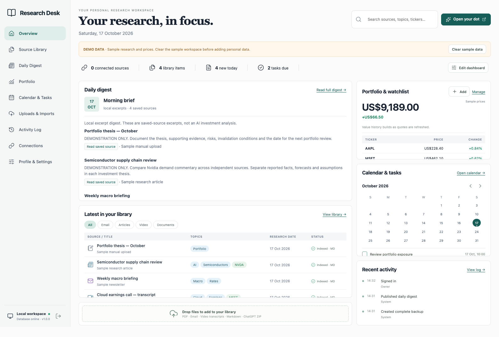

# Research Desk

A local research library and investment dashboard for a Mac, operated by its owner and their actual ChatGPT dot.

The interface follows the approved original design: a light workspace, teal accents, readable source tables and an editorial heading. Move and resize the six dashboard cards in **Edit dashboard**. Add, edit and remove stocks from **Portfolio**.

## Give this link to your friend

https://github.com/handmadeheroes/research-desk

No GitHub account is needed to read or download this public source repository.

Ask their dot, with their Mac connected:

> Install Research Desk from https://github.com/handmadeheroes/research-desk on this Mac. Read INSTALL_WITH_CHATGPT.md first. Inspect the installation scripts, choose the native installation if Python 3.11+ and Node 22+ are available, otherwise explain the Docker option. Install, start and verify the app. Keep generated passwords and tokens private. Read DOT_INSTRUCTIONS.md and verify that you can save and retrieve a test research note. Let me select my ChatGPT export before importing personal research.

## Install on a Mac

Requires Python 3.11+ (3.12 recommended), Node.js 22+ and npm. A current Mac's built-in Python may be too old.

Download and extract the source ZIP from GitHub, or:

    git clone https://github.com/handmadeheroes/research-desk.git
    cd research-desk
    ./scripts/install.sh
    ./scripts/start.sh

Open **http://127.0.0.1:8401**. The installer prints a unique workspace password once. Save it privately. Existing installations keep their data and credentials.

Alternative with Docker Desktop running:

    ./scripts/install.sh --docker
    docker compose logs app

The first-install password appears in the local container log. Docker binds the dashboard only to this Mac's loopback interface.

## What works

- Persistent six-card dashboard layout, drag and drop, resizing and reset.
- Holdings/watchlist CRUD, manual quotes, per-currency valuations and saved-price history.
- Finnhub quote integration using the owner's key; best-effort key-free Stooq daily-close fallback.
- Searchable SQLite FTS5 library with date, source, type, topic and ticker filters.
- Immutable original uploads, Markdown copies, metadata revisions, archive/restore and downloads.
- ChatGPT ZIP/JSON import with conversation selection, all available message branches, stable IDs, deduplication, retries, progress, issues and safe undo of new unchanged records.
- PDF text extraction, EML email, text, Markdown, HTML, CSV and VTT/SRT transcripts.
- RSS/Atom retrieval, public article extraction, unlimited registered source connections subject to the Mac's capacity.
- Cited digest publishing by the actual dot, plus explicitly labelled deterministic excerpt digests.
- Calendar task CRUD, research links and ICS export.
- Actor-labelled audit log for user changes, system jobs, dot searches and dot source reads.
- Authenticated local agent CLI and 19-tool stdio MCP server.
- Daily local backups, verified restore, native macOS auto-start script and Docker restart/health checks.

## Connect stock prices

In **Profile & Settings**, save your own Finnhub API key from a personal account at https://finnhub.io/. Alternatively set FINNHUB_API_KEY in the local .env file and restart.

The supplied adapter supports USD-denominated US stocks. Use AAPL as the stock symbol and aapl.us as the quote symbol. Provider coverage, delays and request limits depend on your account; the app shows the returned timestamp and does not promise exchange-authoritative real-time data. Other currencies/markets can use manually entered prices. No currency conversion or brokerage trading is performed.

Without a key, the app attempts Stooq daily closing prices. Stooq can block automated downloads; this occurred during validation. Failed refreshes preserve the last saved price and expose an error instead of fabricating data.

## Connect your actual dot

See **DOT_INSTRUCTIONS.md**. The supported baseline is the included local skill plus CLI on a connected Mac. A stdio MCP adapter is also included for compatible hosts. Availability and registration of local tools in ChatGPT depend on the account/client.

This app does not embed or impersonate the personal dot, export its private saved notes, or inherit ChatGPT conversations automatically. Talk to the dot in ChatGPT. The dot saves explicit research and decisions into the app.

No OpenAI API key is required by this application. ChatGPT/dot access and market-data accounts are configured by the owner.

## Import previous research

Use **Uploads & Imports**. Supply a ChatGPT export ZIP/JSON that you can obtain from your account, or upload downloaded source files. Review the conversation selection and optional archive-file indexing before starting. Read **docs/IMPORTS.md** first.

Importing preserves dates and message roles; generated summaries remain labelled as AI research. A linked webpage is not its full source text. Missing attachments, scanned PDFs and unsupported files are reported. Actual export formats can vary; pilot a small selection before importing the whole archive.

## Daily operations

    .venv/bin/research-desk status
    .venv/bin/research-desk backup
    .venv/bin/research-desk reset-password
    .venv/bin/research-desk rotate-agent-token

For auto-start at macOS login, stop the foreground server, then:

    ./scripts/install-service.sh

See **docs/BACKUP_RESTORE.md** and **docs/AUTOMATIONS.md**. Backups stored only on the same Mac do not protect against loss of that Mac; copy protected backups to an owner-chosen external/off-device destination.

## Update

Back up first. Stop the native process or launchd service, then:

    git pull --ff-only
    ./scripts/install.sh
    ./scripts/start.sh

For Docker:

    docker compose exec -T app research-desk backup
    docker compose up -d --build

Do not delete Docker volumes when updating. Native data lives in ./data by default; Docker uses its own named research-data volume. Choose one installation mode and follow the migration instructions when switching.

## Development and verification

    uv pip install --python .venv/bin/python -e '.[dev]'
    npm ci
    npm run build
    .venv/bin/ruff check research_desk tests
    .venv/bin/pytest -q
    npx playwright install chromium
    npm run test:e2e

Set PLAYWRIGHT_CHANNEL=chrome to use an installed Chrome instead. The browser suite uses an isolated ignored .test-data folder and port 8407. The real app defaults to 8401.

See **HANDOVER.md**, **HANDOVER_VALIDATION.md**, **SECRETS_REQUIRED.md** and the approved design in docs/design/original.png.
